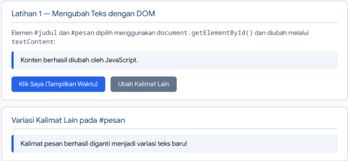
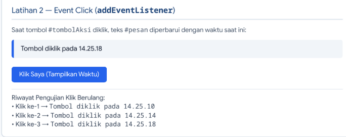
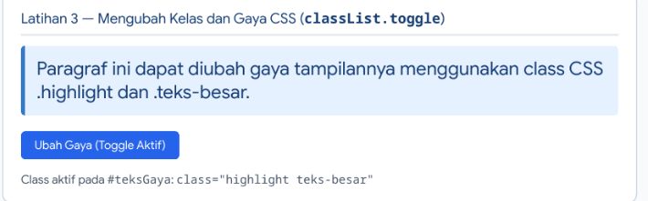
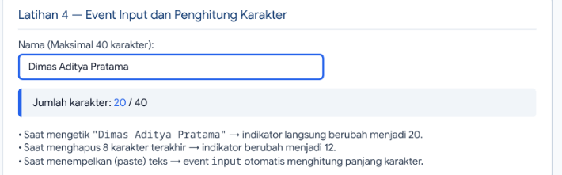
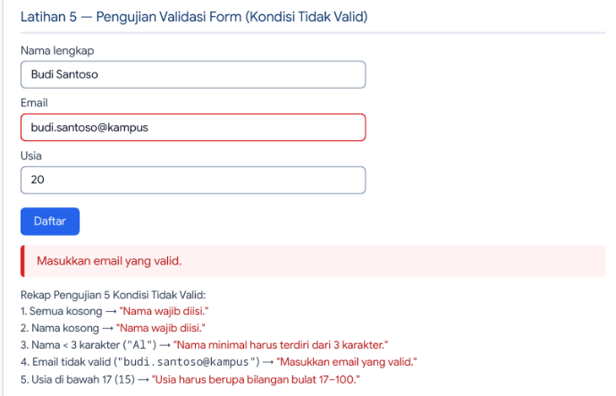
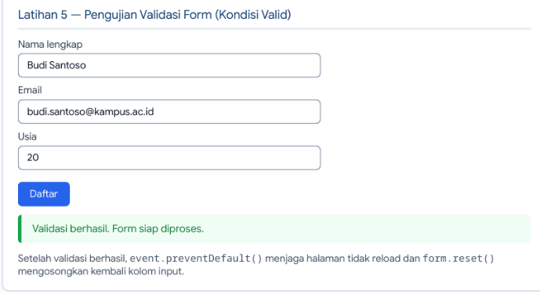
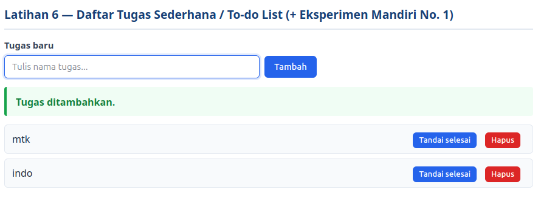
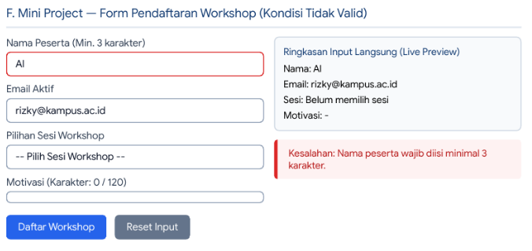
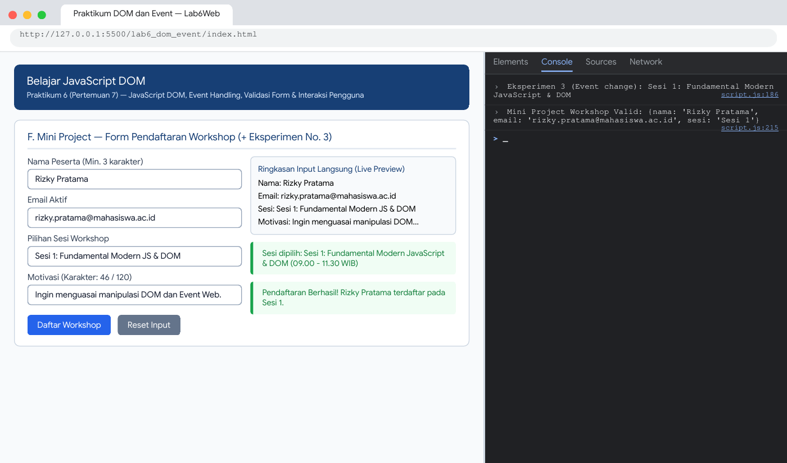
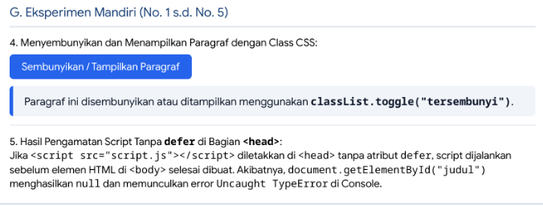

# Praktikum 6: JavaScript DOM dan Event Handling (`Lab6Web`)

Repository ini berisi hasil pengerjaan **Praktikum 6 (Pertemuan 7) — JavaScript DOM dan Event Handling**, mencakup **Latihan 1 s.d. Latihan 6**, **Mini Project (Form Pendaftaran Workshop)**, **Eksperimen Mandiri (No. 1 s.d. No. 5)**, serta **Jawaban Pertanyaan Evaluasi (No. 1 s.d. No. 7)**.

---

## Daftar Isi
1. [Tujuan Praktikum](#1-tujuan-praktikum)
2. [Struktur File Repository](#2-struktur-file-repository)
3. [Langkah Kerja dan Cara Menjalankan](#3-langkah-kerja-dan-cara-menjalankan)
4. [Pembahasan dan Hasil Latihan 1 – 6](#4-pembahasan-dan-hasil-latihan-1--6)
   - [Latihan 1 — Mengubah Teks dengan DOM](#latihan-1--mengubah-teks-dengan-dom)
   - [Latihan 2 — Event Click](#latihan-2--event-click)
   - [Latihan 3 — Mengubah Kelas dan Gaya CSS](#latihan-3--mengubah-kelas-dan-gaya-css)
   - [Latihan 4 — Event Input dan Penghitung Karakter](#latihan-4--event-input-dan-penghitung-karakter)
   - [Latihan 5 — Validasi Form Pendaftaran](#latihan-5--validasi-form-pendaftaran)
   - [Latihan 6 — Daftar Tugas Sederhana (To-do List)](#latihan-6--daftar-tugas-sederhana-to-do-list)
5. [F. Mini Project — Form Pendaftaran Workshop](#5-f-mini-project--form-pendaftaran-workshop)
6. [G. Eksperimen Mandiri](#6-g-eksperimen-mandiri)
7. [H. Jawaban Pertanyaan Evaluasi](#7-h-jawaban-pertanyaan-evaluasi)

---

## 1. Tujuan Praktikum
1. Memahami DOM (*Document Object Model*) sebagai representasi dokumen HTML yang dapat diakses dan dimanipulasi melalui JavaScript.
2. Menggunakan `id`, `class`, dan selector CSS untuk memilih elemen HTML.
3. Mengubah teks, atribut, kelas CSS, dan gaya elemen melalui JavaScript.
4. Menangani event pengguna menggunakan `addEventListener()`.
5. Membuat validasi form dan menampilkan pesan kesalahan maupun pesan sukses sesuai kondisi input.
6. Mengembangkan halaman interaktif dengan minimal tiga fungsi yang berjalan dengan benar.

---

## 2. Struktur File Repository
```text
Lab6Web/ (atau lab6_dom_event/)
├── index.html                                    # Struktur HTML seluruh latihan, Mini Project, & Eksperimen
├── style.css                                     # Aturan gaya CSS (.highlight, .teks-besar, .selesai, .tersembunyi, dll.)
├── script.js                                     # Logika DOM, addEventListener, Validasi Form, To-do List, & Workshop
├── README.md                                     # Laporan lengkap praktikum beserta screenshot
└── screenshots/                                  # Dokumentasi screenshot hasil eksekusi di Browser & Console
    ├── latihan1_ubah_teks_dom.png
    ├── latihan2_event_click.png
    ├── latihan3_toggle_gaya.png
    ├── latihan4_input_karakter.png
    ├── latihan5_form_tidak_valid.png
    ├── latihan5_form_valid.png
    ├── latihan6_todo_list.png
    ├── miniproject_workshop_tidak_valid.png
    ├── miniproject_workshop.png
    └── eksperimen_mandiri.png
```

---

## 3. Langkah Kerja dan Cara Menjalankan

### Langkah Kerja
1. Membuat folder kerja bernama `lab6_dom_event` dan menginisialisasi repository Git bernama `Lab6Web`.
2. Membuat file `index.html`, `style.css`, dan `script.js`.
3. Menghubungkan `style.css` dan `script.js` pada bagian `<head>` di `index.html` menggunakan atribut `defer`:
   ```html
   <link rel="stylesheet" href="style.css">
   <script src="script.js" defer></script>
   ```
4. Mengerjakan kode program secara bertahap mulai dari Latihan 1 hingga Latihan 6, Mini Project (Form Pendaftaran Workshop), dan Eksperimen Mandiri.
5. Menguji seluruh interaksi pada browser serta memantau log pada **Developer Tools (Console)**.

### Cara Menjalankan
1. Clone repository ini ke komputer lokal:
   ```bash
   git clone https://github.com/USERNAME_ANDA/Lab6Web.git
   cd Lab6Web
   ```
2. Buka file `index.html` menggunakan browser modern (Chrome, Firefox, Edge) atau jalankan melalui ekstensi **Live Server** di Visual Studio Code.
3. Buka **Developer Tools** (`F12` atau `Ctrl + Shift + I`) dan pilih tab **Console** untuk melihat log setiap interaksi.

---

## 4. Pembahasan dan Hasil Latihan 1 – 6

### Latihan 1 — Mengubah Teks dengan DOM
**Tujuan:** Memilih elemen HTML berdasarkan `id` (`#judul` dan `#pesan`) menggunakan `document.getElementById()` dan mengubah konten teksnya menggunakan `textContent`.

**Kode Program:**
```javascript
const judul = document.getElementById("judul");
const pesan = document.getElementById("pesan");

judul.textContent = "Belajar JavaScript DOM";
pesan.textContent = "Konten berhasil diubah oleh JavaScript.";
```

**Hasil Pengamatan:**
Saat halaman dimuat, teks `<h1>` yang semula tertulis `"Latihan DOM"` otomatis berubah menjadi `"Belajar JavaScript DOM"`, dan teks `<p id="pesan">` berubah menjadi `"Konten berhasil diubah oleh JavaScript."`. Disediakan pula tombol tambahan untuk mengubah `#pesan` menjadi kalimat variasi lain secara dinamis.

**Screenshot Hasil:**


---

### Latihan 2 — Event Click
**Tujuan:** Menangani event `click` pada tombol `#tombolAksi` menggunakan `addEventListener()` untuk memperbarui teks paragraf `#pesan` disertai waktu tindakan dilakukan.

**Kode Program:**
```javascript
const tombol = document.getElementById("tombolAksi");
const pesan = document.getElementById("pesan");

tombol.addEventListener("click", function () {
    pesan.textContent = "Tombol diklik pada " + new Date().toLocaleTimeString("id-ID");
});
```

**Hasil Pengamatan:**
Setiap kali tombol ditekan, objek `new Date().toLocaleTimeString()` mengambil waktu sistem terbaru dan memperbarui isi elemen `#pesan` secara *real-time* tanpa memuat ulang halaman.

**Screenshot Hasil:**


---

### Latihan 3 — Mengubah Kelas dan Gaya CSS
**Tujuan:** Mengubah tampilan elemen `#teksGaya` secara dinamis dengan menambahkan/menghapus class `.highlight` dan `.teks-besar` saat tombol `#tombolGaya` diklik.

**Kode Program:**
```javascript
const tombolGaya = document.getElementById("tombolGaya");
const teksGaya = document.getElementById("teksGaya");

tombolGaya.addEventListener("click", function () {
    teksGaya.classList.toggle("highlight");
    teksGaya.classList.toggle("teks-besar");
});
```

**Perbedaan `classList.add()`, `classList.remove()`, dan `classList.toggle()`:**
* **`classList.add("nama-class")`**: Menambahkan class CSS ke elemen. Jika class tersebut sudah ada, tidak terjadi duplikasi.
* **`classList.remove("nama-class")`**: Menghapus class CSS tertentu dari elemen.
* **`classList.toggle("nama-class")`**: Memeriksa keberadaan class CSS; jika class belum ada maka ditambahkan (`true`), sedangkan jika sudah ada maka dihapus (`false`).

**Screenshot Hasil:**


---

### Latihan 4 — Event Input dan Penghitung Karakter
**Tujuan:** Membuat input teks dengan batas maksimal 40 karakter dan menampilkan indikator jumlah karakter secara langsung setiap kali pengguna mengetik, menghapus, atau menempelkan (*paste*) teks.

**Kode Program:**
```javascript
const namaInput = document.getElementById("namaInput");
const jumlahKarakter = document.getElementById("jumlahKarakter");

namaInput.addEventListener("input", function () {
    jumlahKarakter.textContent = namaInput.value.length;
});
```

**Screenshot Hasil:**


---

### Latihan 5 — Validasi Form Pendaftaran
**Tujuan:** Memvalidasi form pendaftaran (Nama Lengkap, Email, dan Usia) pada event `submit` menggunakan `event.preventDefault()`, sekaligus menerapkan **Eksperimen Mandiri No. 2** (nama minimal terdiri dari 3 karakter).

**Kode Program:**
```javascript
form.addEventListener("submit", function (event) {
    event.preventDefault();

    const nama = document.getElementById("nama").value.trim();
    const email = document.getElementById("email").value.trim();
    const usiaInput = document.getElementById("usia").value.trim();
    const usia = Number(usiaInput);
    const polaEmail = /^[^\s@]+@[^\s@]+\.[^\s@]+$/;

    if (nama === "") {
        pesanForm.textContent = "Nama wajib diisi.";
    } else if (nama.length < 3) {
        pesanForm.textContent = "Nama minimal harus terdiri dari 3 karakter.";
    } else if (!polaEmail.test(email)) {
        pesanForm.textContent = "Masukkan email yang valid.";
    } else if (usiaInput === "" || !Number.isInteger(usia) || usia < 17 || usia > 100) {
        pesanForm.textContent = "Usia harus berupa bilangan bulat 17–100.";
    } else {
        pesanForm.textContent = "Validasi berhasil. Form siap diproses.";
        form.reset();
    }
});
```

**Hasil Pengujian 6 Kondisi Input:**
| No | Kondisi Pengujian | Input (`Nama`, `Email`, `Usia`) | Output pada `#pesanForm` | Status |
| :-: | :--- | :--- | :--- | :-: |
| 1 | Semua kosong | `""`, `""`, `""` | `Nama wajib diisi.` | Tidak Valid |
| 2 | Nama kosong | `""`, `budi@kampus.ac.id`, `20` | `Nama wajib diisi.` | Tidak Valid |
| 3 | Nama < 3 karakter | `"Al"`, `budi@kampus.ac.id`, `20` | `Nama minimal harus terdiri dari 3 karakter.` | Tidak Valid |
| 4 | Email tidak valid | `"Budi Santoso"`, `budi.santoso@kampus`, `20` | `Masukkan email yang valid.` | Tidak Valid |
| 5 | Usia di bawah 17 | `"Budi Santoso"`, `budi@kampus.ac.id`, `15` | `Usia harus berupa bilangan bulat 17–100.` | Tidak Valid |
| 6 | Semua input valid | `"Budi Santoso"`, `budi.santoso@kampus.ac.id`, `20` | `Validasi berhasil. Form siap diproses.` | **Valid** |

**Screenshot Kondisi Tidak Valid:**


**Screenshot Kondisi Valid:**


---

### Latihan 6 — Daftar Tugas Sederhana (To-do List)
**Tujuan:** Membuat aplikasi *To-do List* untuk menambahkan item tugas baru (`document.createElement`), menandai tugas selesai (`classList.toggle("selesai")`), serta menambahkan tombol **Hapus** untuk menghapus satu item tugas (**Eksperimen Mandiri No. 1**).

**Screenshot Hasil:**


---

## 5. F. Mini Project — Form Pendaftaran Workshop
Halaman **Form Pendaftaran Workshop** dirancang responsif dan memiliki empat fitur interaktif utama menggunakan `addEventListener()`:
1. **Validasi Komprehensif (`submit`)**: Memeriksa nama peserta (minimal 3 karakter), kecocokan pola RegExp email, dan memastikan peserta telah memilih salah satu sesi workshop.
2. **Ringkasan Input Secara Langsung / *Live Preview* (`input`) & Penghitung Karakter**: Setiap ketikan pada kolom Nama, Email, dan Motivasi langsung memperbarui kartu *Ringkasan Input Langsung* dan indikator panjang karakter (`0 / 120`).
3. **Deteksi Perubahan Sesi Workshop (`change`)**: Menerapkan **Eksperimen Mandiri No. 3**, di mana pemilihan dropdown sesi langsung memicu event `change` dan menampilkan nama serta jadwal sesi yang dipilih.
4. **Tombol Reset Input (`click`)**: Mengosongkan seluruh kolom form, mengembalikan tampilan ringkasan ke nilai awal, dan mereset pesan status.

**Screenshot Mini Project (Kondisi Tidak Valid):**


**Screenshot Mini Project (Kondisi Valid):**


---

## 6. G. Eksperimen Mandiri
1. **Menambahkan tombol hapus satu item dari To-do List:** Diimplementasikan pada Latihan 6 menggunakan elemen `<button class="danger">Hapus</button>` dengan event listener `click` yang memanggil `item.remove()`.
2. **Mengubah validasi agar nama minimal terdiri dari tiga karakter:** Diimplementasikan pada Latihan 5 dan Mini Project dengan pemeriksaan `nama.length < 3`.
3. **Menambahkan event `change` pada dropdown sesi workshop:** Diimplementasikan pada `#wsSesi` menggunakan `wsSesi.addEventListener("change", ...)` yang langsung menampilkan sesi yang dipilih pada elemen `#infoSesiChange` dan `#previewSesi`.
4. **Membuat tombol untuk menyembunyikan dan menampilkan paragraf menggunakan class CSS:** Menggunakan aturan CSS `.tersembunyi { display: none; }` dan fungsi `paragrafEksperimen.classList.toggle("tersembunyi")`.
5. **Memindahkan `<script src="script.js"></script>` tanpa atribut `defer` ke bagian `<head>`:**
   * **Masalah yang Terjadi:** Manipulasi DOM gagal dijalankan dan muncul pesan kesalahan di Console: `Uncaught TypeError: Cannot set properties of null (setting 'textContent')` serta `Cannot read properties of null (reading 'addEventListener')`.
   * **Penyebab:** Browser membaca dokumen HTML dari atas ke bawah. Jika tag `<script>` diletakkan di `<head>` tanpa atribut `defer`, script langsung diunduh dan dieksekusi saat itu juga **sebelum** browser membaca tag `<body>`. Akibatnya, elemen seperti `#judul`, `#pesan`, dan `#tombolAksi` belum terbentuk di pohon DOM sehingga `document.getElementById()` mengembalikan nilai `null`. Atribut `defer` menunda eksekusi script hingga seluruh dokumen HTML selesai diparsing.

**Screenshot Hasil Eksperimen Mandiri:**


---

## 7. H. Jawaban Pertanyaan Evaluasi

### 1. Apa yang dimaksud dengan DOM dan apa manfaatnya?
**Document Object Model (DOM)** adalah antarmuka pemrograman (API) yang merepresentasikan struktur dokumen HTML dalam bentuk pohon objek (*tree of objects*) di memori browser. Manfaat utamanya adalah memungkinkan JavaScript untuk mengakses, membaca, mengubah konten teks, memodifikasi atribut dan gaya CSS, menambah atau menghapus elemen HTML secara dinamis, serta merespons interaksi pengguna tanpa perlu memuat ulang halaman web.

### 2. Apa perbedaan `getElementById()`, `querySelector()`, dan `querySelectorAll()`?
* **`document.getElementById("id")`**: Memilih satu elemen spesifik berdasarkan nilai atribut `id`. Mengembalikan objek `Element` (atau `null` jika tidak ditemukan) dan memiliki performa paling cepat untuk pencarian `id`.
* **`document.querySelector("selector")`**: Memilih **elemen pertama** yang cocok dengan selector CSS apa pun (bisa berupa `#id`, `.class`, tag, atau kombinasi selector kompleks). Mengembalikan satu objek `Element` atau `null`.
* **`document.querySelectorAll("selector")`**: Memilih **semua elemen** yang cocok dengan selector CSS yang diberikan dan mengembalikannya dalam bentuk `NodeList` statis (dapat diiterasi dengan `.forEach()`).

### 3. Apa fungsi `addEventListener()` dan sebutkan tiga contoh event?
`addEventListener()` berfungsi untuk mendaftarkan atau menghubungkan suatu kejadian (*event*) pada elemen DOM dengan fungsi *callback* (*event handler*) yang akan dijalankan ketika kejadian tersebut terjadi, tanpa menimpa handler lain pada elemen yang sama.
**Tiga contoh event:**
1. `click`: Terjadi ketika pengguna menekan dan melepas klik mouse pada elemen (misalnya tombol).
2. `input`: Terjadi setiap kali nilai pada elemen `<input>` atau `<textarea>` berubah saat pengguna mengetik.
3. `submit`: Terjadi ketika sebuah `<form>` dikirimkan oleh pengguna. (Contoh lain: `change`, `keydown`, `mouseover`).

### 4. Mengapa `event.preventDefault()` digunakan pada event submit form?
Secara bawaan (*default*), ketika sebuah form HTML di-submit, browser akan mengirimkan data ke URL tujuan dan **memuat ulang (reload) halaman**. Pemanggilan `event.preventDefault()` menghentikan perilaku bawaan tersebut agar halaman tidak ter-reload, sehingga JavaScript dapat memeriksa validitas input terlebih dahulu dan menampilkan pesan kesalahan atau pesan sukses secara langsung di halaman.

### 5. Apa perbedaan `textContent` dan `innerHTML` dari sisi penggunaan dan keamanan?
* **Dari sisi penggunaan:** `textContent` hanya mengatur atau mengambil teks murni di dalam elemen (semua tag HTML akan ditampilkan apa adanya sebagai teks biasa), sedangkan `innerHTML` membaca atau menyisipkan string yang diparsing sebagai markup HTML aktif.
* **Dari sisi keamanan:** `textContent` **jauh lebih aman** untuk menampilkan input dari pengguna karena mencegah eksekusi tag `<script>` berbahaya. Sebaliknya, memasukkan teks pengguna yang tidak dipercaya ke dalam `innerHTML` menimbulkan celah keamanan **Cross-Site Scripting (XSS)** karena kode berbahaya dapat dieksekusi oleh browser.

### 6. Bagaimana `classList.toggle()` membantu mengubah tampilan elemen?
`classList.toggle("nama-class")` bekerja seperti saklar (*switch*) otomatis: jika elemen belum memiliki class CSS tersebut, metode ini akan menambahkannya; sebaliknya jika elemen sudah memilikinya, metode ini akan menghapusnya. Hal ini membuat kode JavaScript jauh lebih ringkas dan bersih dibandingkan menulis percabangan `if–else` manual dengan `classList.contains()`, `add()`, dan `remove()`.

### 7. Sebutkan minimal tiga skenario pengujian validasi form.
1. **Skenario Input Kosong (Empty Input):** Mengirimkan form saat seluruh kolom atau salah satu kolom wajib (seperti Nama atau Email) masih kosong atau hanya berisi spasi.
2. **Skenario Format Tidak Sesuai (Invalid Format / Length):** Memasukkan nama kurang dari 3 karakter (misal `"Al"`) atau memasukkan alamat email tanpa tanda `@` dan domain yang benar (misal `"budi@kampus"`).
3. **Skenario Nilai di Luar Rentang (Out-of-Range / Boundary Value):** Memasukkan nilai usia di bawah batas minimum (`< 17`, misal `15`), di atas batas maksimum (`> 100`, misal `120`), atau berupa bilangan desimal.
4. **Skenario Input Valid (Valid Input):** Memasukkan seluruh data sesuai ketentuan (Nama minimal 3 karakter, format email valid, dan usia bilangan bulat 17–100) untuk memastikan pesan sukses muncul dan form berhasil direset.
